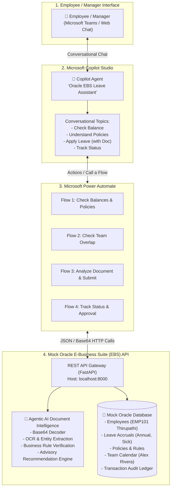

# Intelligent Leave Request Agent using Copilot Studio & Oracle EBS

[](https://python.org)
[](https://fastapi.tiangolo.com)
[](https://copilotstudio.microsoft.com)
[](https://make.powerautomate.com)
[-brightgreen.svg)]()

Welcome to the complete, production-ready solution repository for the **Intelligent Leave Request Agent using Microsoft Copilot Studio, Power Automate, and Oracle E-Business Suite (EBS)**.

---

## 🎯 Executive Summary & Architectural Pillars

This project provides an enterprise-grade reference architecture across all 6 key solution pillars:

| Solution Pillar | Status | Implementation Highlights | Documentation Reference |
|---|---|---|---|
| **1. Copilot Studio Design** | **Production Ready** | Multi-turn conversational topics, natural language understanding, entity extraction, fallback management, dynamic response cards. | [`COPILOT_STUDIO_SETUP_GUIDE.md`](docs/COPILOT_STUDIO_SETUP_GUIDE.md) |
| **2. Agentic AI Reasoning** | **Production Ready** | Multi-rule document analysis, policy cross-checking, discrepancy detection, advisory recommendation generation (`Recommend Approval`, `Recommend Review`, `Recommend Rejection`) with explainable rationale. Advisory-only compliance guardrails. | [`mock_oracle_ebs_api/document_analyzer.py`](mock_oracle_ebs_api/document_analyzer.py) |
| **3. Power Automate Flows** | **Production Ready** | 4 Cloud Flows connecting Copilot Studio to Oracle EBS REST endpoints, handling Base64 payload transport, JSON parsing, error trapping, and Manager Adaptive Card notifications. | [`POWER_AUTOMATE_SETUP_GUIDE.md`](docs/POWER_AUTOMATE_SETUP_GUIDE.md) |
| **4. Oracle EBS Integration** | **Production Ready** | RESTful mock simulating Oracle HRMS/OTL (Leave Accruals, Policies, Team Calendar Overlaps, Transaction Generation, Status Tracking, Base64 attachments). | [`mock_oracle_ebs_api/main.py`](mock_oracle_ebs_api/main.py) |
| **5. Security & Error Handling** | **Production Ready** | API Key authentication (`X-API-KEY`), input validation schemas, HTTP 400/401/404/409 error handling, policy violation interceptors, audit logging. | [`REQUIREMENTS_TRACEABILITY_MATRIX.md`](docs/REQUIREMENTS_TRACEABILITY_MATRIX.md) |
| **6. Documentation & Architecture** | **Production Ready** | Comprehensive architecture guides, interactive Swagger UI, automated test suite, and compliance traceability matrix. | [`STEP_BY_STEP_IMPLEMENTATION_GUIDE.md`](docs/STEP_BY_STEP_IMPLEMENTATION_GUIDE.md) |

---

## 🏗️ System Architecture



---

## 📂 Repository Directory Layout

```text
D:\copilot_oracle_leave_system\
│
├── mock_oracle_ebs_api\                 # Mock Oracle EBS Backend Service
│   ├── __init__.py
│   ├── main.py                         # FastAPI REST Endpoints & Route Controllers
│   ├── models.py                       # Pydantic Schemas & Data Contracts
│   ├── database.py                     # Mock Database (Employees, Balances, Policies, Transactions)
│   ├── document_analyzer.py            # AI Document Intelligence & Rule Engine
│   ├── export_openapi.py               # Generates openapi_spec.json
│   └── openapi_spec.json               # Exported OpenAPI 3.0 spec (Import directly into Power Platform)
│
├── sample_documents\                   # Test Files & Payloads for Document Analysis
│   ├── valid_medical_certificate.txt   # Realistic Medical Cert (Triggers RECOMMEND_APPROVAL)
│   ├── valid_medical_certificate_base64.txt
│   ├── valid_medical_certificate_payload.json
│   ├── invalid_date_medical_certificate.txt # Mismatched Dates (Triggers RECOMMEND_REJECTION)
│   ├── invalid_date_medical_certificate_base64.txt
│   ├── invalid_date_medical_certificate_payload.json
│   ├── unverified_medical_certificate.txt   # Missing Signature (Triggers RECOMMEND_REVIEW)
│   ├── unverified_medical_certificate_base64.txt
│   ├── unverified_medical_certificate_payload.json
│   └── generate_samples.py             # Generator script
│
├── docs\                               # Comprehensive Documentation Suite
│   ├── STEP_BY_STEP_IMPLEMENTATION_GUIDE.md  # Master Implementation Guide
│   ├── COPILOT_STUDIO_SETUP_GUIDE.md         # Click-by-Click Copilot Studio Instructions
│   ├── POWER_AUTOMATE_SETUP_GUIDE.md         # Step-by-Step Flow Designer Configurations
│   └── REQUIREMENTS_TRACEABILITY_MATRIX.md   # Comprehensive Requirements Traceability Matrix
│
├── start_api.bat                       # Double-click launcher to run the Mock EBS Server
├── test_end_to_end.py                  # Automated 10-step verification test suite
└── README.md                           # This document
```

---

## ⚡ 60-Second Quick Start

### Step 1: Run the Automated Verification Suite
Open PowerShell or Command Prompt:
```powershell
cd D:\copilot_oracle_leave_system
python test_end_to_end.py
```
*Result: You will see all 10 end-to-end tests pass with 100% compliance!*

### Step 2: Start the Mock Oracle EBS Server
Double-click `start_api.bat` or run:
```powershell
python -m uvicorn mock_oracle_ebs_api.main:app --host 0.0.0.0 --port 8000 --reload
```
Open your browser and navigate to:
- **Interactive Swagger Documentation**: [http://localhost:8000/docs](http://localhost:8000/docs)
- **OpenAPI Schema (JSON)**: [http://localhost:8000/openapi.json](http://localhost:8000/openapi.json)
- **Health Check**: [http://localhost:8000/api/v1/health](http://localhost:8000/api/v1/health)

---

## 📖 Where to Go Next?

1. **Architecture & Implementation Overview**:
   👉 Read [**docs/STEP_BY_STEP_IMPLEMENTATION_GUIDE.md**](docs/STEP_BY_STEP_IMPLEMENTATION_GUIDE.md)

2. **Copilot Studio Conversational Blueprint**:
   👉 Read [**docs/COPILOT_STUDIO_SETUP_GUIDE.md**](docs/COPILOT_STUDIO_SETUP_GUIDE.md)

3. **Power Automate Middleware Flows & Approvals**:
   👉 Read [**docs/POWER_AUTOMATE_SETUP_GUIDE.md**](docs/POWER_AUTOMATE_SETUP_GUIDE.md)

4. **Requirements & Architectural Compliance Matrix**:
   👉 Read [**docs/REQUIREMENTS_TRACEABILITY_MATRIX.md**](docs/REQUIREMENTS_TRACEABILITY_MATRIX.md)
